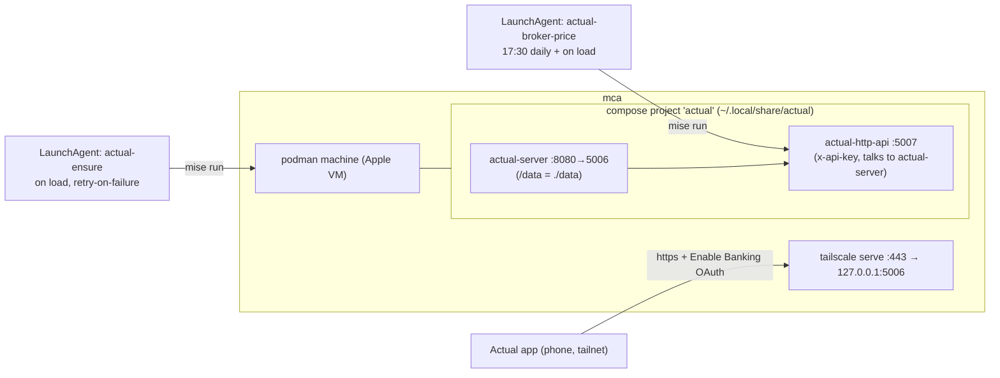

# Plan: Actual Budget on mca (podman + mise)

Status: ready to implement. Target host: **mca** (laptop). Every fact below was
verified against the cited source (mise source/docs at the installed release,
actualbudget/actual@master, jhonderson/actual-http-api@main, podman docs v5.6,
brew formulae) on 2026-10-22.

## Decisions (user-confirmed)

| Question | Answer |
|---|---|
| Host | **mca** — the laptop. Consequence: containers only run while mca is awake; bank sync and price updates are deferred, not lost, while it sleeps (the app catches up next open; launchd fires missed calendars on wake). |
| Bank transactions | **Knab → Actual's built-in Enable Banking** (covers Knab; verified in the NL provider list). No file pipeline. |
| Net worth | Broker account, **prices fetched automatically** (yfinance), **quantities maintained manually** in the account's note (`#holding <qty> <TICKER>` lines — the upstream example's design). One adjustment transaction per run via `actual-http-api`. |
| Remote access | **tailscale serve** (https on the tailnet; required for the Enable Banking OAuth callback; phone access anywhere). |

Engine: **podman** (brew formula) + **docker-compose** (brew formula, the
frontend `podman compose` execs) in a user-land VM (`podman-machine-default`).
Native surfaces used: brew packages, `bootstrap.directories`/`files`,
`bootstrap.secrets`, `bootstrap.compose`, `bootstrap.macos.launchd.agents`,
`bootstrap.hooks`. Tasks (things mise cannot express natively): the machine
init guard, the first-run bootstrap check, tailscale serve, and the price
fetcher. Alternatives rejected: Docker Desktop (subscription/GUI), OrbStack
(GUI app, not rootless-open), colima (VM management for the same docker
stack — no advantage here), apple's `container` (no compose).

## Architecture



Bank sync needs no agent: the **client** triggers it (docs: "syncing only
happens while Actual is open; it catches up the next time you open it") — the
phone app hits the server-side `/enablebanking` module, which fetches Knab.

## Files

| File | Change |
|---|---|
| `Brewfile.mca` | + `brew "podman"`, `brew "docker-compose"` (verify `brew deps podman` shows none, so both are explicit) |
| `mise.mca.toml` | + `[bootstrap.secrets]`, `[bootstrap.directories]`, `[bootstrap.files]` (compose.yaml, .env), `[bootstrap.compose.actual]`, two launchd agents (below) |
| `mise.toml` | `pre-packages` hook: append `mise run actual-ensure` **non-fatally** (`\|\| echo "WARNING: actual is not up; the LaunchAgent will retry"`); `final` hook: append `mise run actual-ensure` (convergence backstop; no-op off mca) |
| `mise-tasks/actual-ensure` | new, bash |
| `mise-tasks/actual-status` | new, bash |
| `mise-tasks/actual-broker-price` | new, bash (calls `uv run --script`) |
| `actual/compose.yaml` | new (plain file, no template) |
| `actual/broker-price.py` | new (PEP 723, adapted from the upstream example — credit in header) |
| `README.md` | short "Actual Budget (mca)" section: what/where, the runbook, the sleep caveat |
| `.gitignore` | + `plans/` (local planning docs are not dotfiles) |

### mise.mca.toml additions

```toml
[bootstrap.secrets.actual_password]
description = "Actual server login password (the app's single-user password)"

[bootstrap.secrets.actual_api_key]
description = "actual-http-api key; generate with: openssl rand -hex 16"

[bootstrap.directories."{{ env.HOME }}/.local/share/actual"]
mode = "0755"

[bootstrap.files."{{ env.HOME }}/.local/share/actual/compose.yaml"]
source = "actual/compose.yaml"
mode = "0644"

[bootstrap.files."{{ env.HOME }}/.local/share/actual/.env"]
content = """
ACTUAL_SERVER_PASSWORD={{ secret(name="actual_password") }}
ACTUAL_SERVER_URL=http://actual-server:5006/
API_KEY={{ secret(name="actual_api_key") }}
NODE_ENV=production
"""
template = true
mode = "0600"

[bootstrap.compose.actual]
project_dir = "{{ env.HOME }}/.local/share/actual"
files = ["compose.yaml"]
env_files = [".env"]
project_name = "actual"
state = "running"
command = ["podman", "compose"]
engine_command = ["podman"]
pull = true
depends_on = ["package:brew:podman"]
```

(`project_name`/`sudo`/`depends_on` are real fields from the compose doc's
mise-cache example; the exact per-file nesting is confirmed by
`mise bootstrap files apply --dry-run` during implementation.)

### actual/compose.yaml

```yaml
services:
  actual-server:
    image: actualbudget/actual-server:<PINNED-TAG>  # pin the current stable version tag (Docker Hub) at implementation; not :latest
    ports: ["127.0.0.1:5006:8080"]
    volumes: ["./data:/data"]
    restart: unless-stopped
  actual-http-api:
    image: jhonderson/actual-http-api:26.10.0      # verified current (260 stars, active 3 days ago)
    ports: ["127.0.0.1:5007:5007"]
    env_file: .env                                 # ACTUAL_SERVER_URL/_PASSWORD, API_KEY
    depends_on: [actual-server]
    restart: unless-stopped
```

Ports bind 127.0.0.1 only; the tailnet path is tailscale serve. The trailing
slash in `ACTUAL_SERVER_URL` matches the upstream example.

### Tasks (bash, mirror the brew-bundle style: shebang, `set -euo pipefail`, REPO via BASH_SOURCE)

All three begin with the mca guard:
`[ "${HOST:-}" = "mca" ] || exit 0` (HOST is set per module; safe in the base
hooks that run on all machines).

**mise-tasks/actual-ensure** (idempotent; run by the agent and by bootstrap):
1. `DIR="$HOME/.local/share/actual"`; require `podman` + `$DIR/compose.yaml` (warn and exit 0 if the project is absent — mca may be a fresh box mid-bootstrap).
2. Machine: `podman machine list --format '{{.Name}} {{.Running}}'` — no machine → `podman machine init --now --cpus 2 --memory 4096 --disk-size 32` (verify the flag names against brew podman 6.1.4's `--help`; v5.6 docs: `--cpus`, `--memory` MiB, `--disk-size` GiB, `--now`); a machine with `Running=false` → `podman machine start` (v5 start *errors* if already running, hence the state check first — re-verify on 6.x).
3. `podman compose -f "$DIR/compose.yaml" -p actual up -d --wait`.
4. `tailscale serve --set-path / 127.0.0.1:5006` (idempotent; verify nothing else on mca owns 443).
5. First-run password: `needs=$(curl -s http://127.0.0.1:5006/account/needs-bootstrap | jq -r '.data.needsBootstrap')` (confirm the response shape live). `true` → `curl -s -X POST http://127.0.0.1:5006/account/bootstrap -H 'Content-Type: application/json' -d '{"password":"<from .env>"}'` (password read from `$DIR/.env`, not from mise secrets — the rendered file is the interface). `false` → do nothing. The image may pre-generate a random password at startup (official first-run behavior, printed to logs); in that case `needsBootstrap` is `false` and the runbook's branch B applies.

**mise-tasks/actual-status**: machine list, `podman compose -p actual ps`, needs-bootstrap, `tailscale serve status`, last lines of the broker log. User health check.

**mise-tasks/actual-broker-price**: `set -a; . "$DIR/.env"; set +a` then
`uv run --script "$REPO/actual/broker-price.py"`. `uv` is the shared Brewfile
entry; `uv run --script` resolves PEP 723 deps into a throwaway venv (no mise `uses`, no system deps).

### actual/broker-price.py

PEP 723 header: `requires-python = ">=3.10"`, `dependencies = ["yfinance", "requests"]`.
Adapted from `jhonderson/actual-http-api/examples/update_account_balances.py`
(credit + URL in the header; upstream is the reference for the flow).

- Config from env: `ACTUAL_BASE_URL` (default `http://127.0.0.1:5007/v1`),
  `ACTUAL_API_KEY` (required), `ACTUAL_BUDGET_NAME` (optional),
  `ACTUAL_DRY_RUN=1` (print the transaction, post nothing). Auth: `x-api-key` header.
- Budget discovery: `GET /budgets` — exactly one → use it; more → match
  `ACTUAL_BUDGET_NAME`, else fail loudly. (Avoids a committed UUID that would
  need re-rendering after the first import.)
- For each account with `offbudget && !closed` (the verified Account fields):
  `note = GET /budgets/{id}/notes/account/{account_id} or ""`; parse lines
  `#holding <qty> <TICKER>` and `#holding <amount> CASH` (upstream format).
  No holdings → skip.
- Prices: `yf.Ticker(t).fast_info.lastPrice` → fallback `info.regularMarketPrice`
  (upstream). **If any ticker fails: log a warning and skip the whole account
  for this run** — never write a partial-portfolio balance.
- `total_cents = Σ qty*price*100` (CASH adds `amount*100`); `cur = GET .../accounts/{id}/balance` (cents); `diff = total - cur`; `abs(diff) < 1` → done.
- Else `POST /budgets/{id}/accounts/{id}/transactions` with
  `{"transaction": {"account": id, "date": today, "amount": diff, "payee_name": "", "notes": "Market value update"}}` (upstream write path, verified).
- Single-currency assumption (one broker account; prices are in listing
  currency, CASH in account currency) — state it in the header comment.

### LaunchAgents (mise.mca.toml, same field set as the gza omlx/splash agents)

```toml
[bootstrap.macos.launchd.agents.actual-budget]
program = "/bin/bash"
args = ["-c", "mise run actual-ensure"]
run_at_load = true
keep_alive_on_failure = true
environment = { "PATH" = "{{ system_brew_prefix }}/bin:{{ system_brew_prefix }}/sbin:/usr/bin:/bin:/usr/sbin:/sbin" }
working_directory = "{{ env.HOME }}"
stdout_path = "{{ env.HOME }}/Library/Logs/actual-budget.log"
stderr_path = "{{ env.HOME }}/Library/Logs/actual-budget.log"
kickstart = true

[bootstrap.macos.launchd.agents.actual-broker-price]
program = "/bin/bash"
args = ["-c", "mise run actual-broker-price"]
run_at_load = true
start_calendar_interval = [{ hour = 17, minute = 30 }]
keep_alive_on_failure = true
environment = { "PATH" = "{{ system_brew_prefix }}/bin:{{ system_brew_prefix }}/sbin:/usr/bin:/bin:/usr/sbin:/sbin" }
working_directory = "{{ env.HOME }}"
stdout_path = "{{ env.HOME }}/Library/Logs/actual-broker-price.log"
stderr_path = "{{ env.HOME }}/Library/Logs/actual-broker-price.log"
```

`start_calendar_interval` is a real launchd field (verified in the launchd
doc). `mise` resolves on that PATH (brew prefix); tasks run from the global
config regardless of cwd.

## First-run runbook (user, on mca)

1. `git pull && mise bootstrap --prompt-secrets` — enter a strong
   `actual_password`; paste `openssl rand -hex 16` for `actual_api_key`.
   First run downloads the podman VM image (~1–2 GB).
2. `mise run actual-status`. If it reports **needs-bootstrap = false** with a
   password you didn't set: the image generated its own random one —
   `podman compose -p actual logs actual-server | grep -i password`, log in
   once at `http://localhost:5006` with it, change the password in settings
   to your secret, re-run `mise bootstrap --prompt-secrets` so the stored
   secret matches, then `mise run actual-ensure`.
3. Open the app: phone `https://mca.foxhound-insen.ts.net` (Tailscale app) or
   desktop `http://localhost:5006` → create/import your budget.
4. **Enable Banking** (Knab): account at enablebanking.com → note the
   registered redirect URL `https://mca.foxhound-insen.ts.net/enablebanking/auth_callback`
   (the module mounts at `/enablebanking`, route `/auth_callback`; verify
   against the live app) → in Actual: **+ account → link → Enable Banking →**
   paste the provider key → consent → select Knab. Done — the app auto-syncs
   Knab while open (Experimental, issue #7793; expect a PSD2 re-consent every
   few months — it re-prompts in the app).
5. **Broker**: + account → name it, **off-budget + include in net worth** →
   in its note, one line per holding: `#holding 12 AAPL`, plus
   `#holding 500 CASH` for cash. Then
   `ACTUAL_DRY_RUN=1 mise run actual-broker-price` (prints prices + the
   proposed adjustment; confirm your tickers resolve), then the real run.
   The 17:30 agent then keeps it current.

## Verification (implementer)

- `mise bootstrap --dry-run`: secrets prompt, .env 0600 render, compose file, agents.
- Machine init on a cold mca; `podman compose up -d --wait`; compose v5 frontend against the podman socket (if it misbehaves: set `PODMAN_COMPOSE_PROVIDER` to the brew `podman-compose` 1.6.0 and add that formula — do not add it preemptively).
- Swagger `http://127.0.0.1:5007/api-docs/`: confirm the four endpoints we use (`/budgets`, `/budgets/{id}/notes/account/{aid}`, `.../balance`, `.../transactions`) exist in the pinned tag and are **not** flagged experimental (the README marks some operations as relying on Actual internals; `EXPERIMENTAL_OPERATIONS_ENABLED` defaults on — if ours are experimental, pin the tag hard and note the fallback = manual balance in the UI).
- `curl localhost:5006/account/needs-bootstrap`; login curl; broker dry-run + real run; `https://mca.foxhound-insen.ts.net` from a phone.
- `launchctl print gui/$(id -u)/dev.mise.actual-budget` (label convention from the syncthing agent); full bootstrap re-run → no drift, no duplicate containers.

## Known trade-offs (accepted)

- Laptop sleep: no containers while mca sleeps; everything converges on wake (agent + client catch-up). gza was the alternative; mca was chosen.
- yfinance is an unofficial Yahoo feed: a failed fetch skips the run rather than writing a wrong value.
- Enable Banking is Experimental upstream; the robust fallback (file import via the http-api's `POST /v1/budgets/import`) is one task away if it ever breaks, but is not built now.
- `restart: unless-stopped` + the ensure agent is the container supervision; podman has no systemd inside to lean on.
